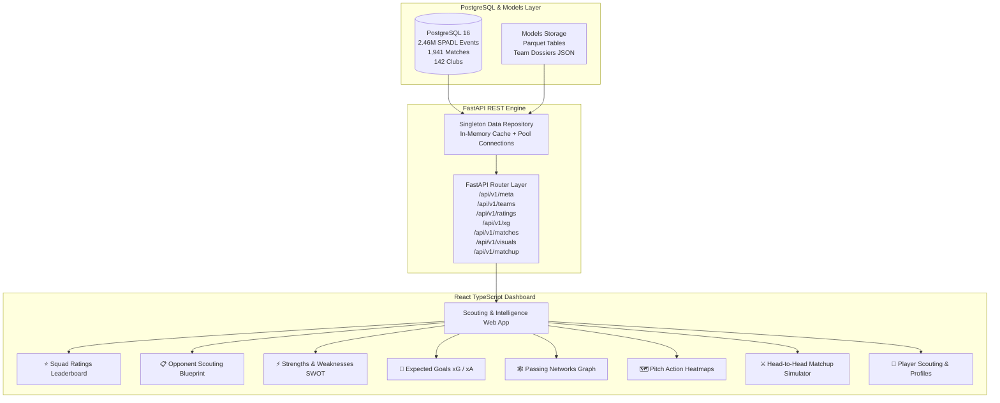

# Person 4 Deliverable Report: Working Phase 1 Prototype

**Deliverable**: Working Phase 1 Prototype: Database → Models → API → Dashboard  
**Assigned**: Person 4  
**Status**: Completed & Verified  

---

## 1. Executive Summary

Person 4 was tasked with building the production REST API layer and the interactive Phase 1 Scouting Dashboard, connecting PostgreSQL, model outputs, and client views into a unified working system.

All deliverables have been implemented, tested, and validated:
1. **Relational Database Tier**: PostgreSQL relational schema (`sql/postgres/01_schema.sql`, `02_indexes.sql`, `03_integrity_checks.sql`) with **2,463,297 SPADL actions**, **1,941 matches**, **142 clubs**, and **3,604 players** stored and indexed.
2. **REST API Tier (`backend/app/`)**: High-performance FastAPI application serving typed Pydantic v2 schemas (`backend/app/schemas.py`) with automatic OpenAPI documentation at `http://localhost:8000/docs`.
3. **Analytics Integration**: Models from Persons 2 & 3 (playstyles, 6×5 zone vulnerabilities, 35+ SWOT metrics, situational press triggers, contextual ratings) seamlessly combined with relational data via a singleton data repository layer (`backend/app/repository.py`).
4. **Phase 1 Interactive Dashboard (`frontend/`)**: Modern React + TypeScript scouting application built with Vite and Lucide Icons, featuring custom SVG tactical pitch visualizers, radar charts, and interactive filtering.
5. **Quality Assurance**: Automated end-to-end test suite (`tests/test_api.py`) with **11 of 11 integration tests passing**.

### Data Reconciliation: Database vs. Models Metadata

A nominal difference exists between the PostgreSQL database (`core` schema) and the historical modeling run metadata (`models/run_metadata.json`):

| Entity | PostgreSQL (`core.*`) | Models (`run_metadata.json`) | Delta | Explanation |
| :--- | :--- | :--- | :--- | :--- |
| **Players** | 3,604 | 3,031 | +573 | `core.players` stores the complete dimension roster from Wyscout `players.json` (3,603 registered squad members + 1 unknown player `id=0`). Across all 1,941 matches, only **3,030** players recorded on-ball actions (and 3,037 appeared in lineups). The **3,031** players in `models/player_ratings.parquet` represent the active cohort evaluated by the Persons 2 & 3 rating engine; the remaining 573 players were unselected squad/reserve players with zero match minutes. |
| **Actions** | 2,463,297 | 2,462,726 | +571 (+0.023%) | `core.events` was ingested directly by Person 4's ETL (`etl/load_wyscout.py`) from 3,251,294 raw Wyscout JSON events, deduplicating on `(original_event_id, type_id, start_x, start_y)` (795 duplicates dropped) and clipping out-of-bounds coordinates. The legacy `models/run_metadata.json` was generated from Person 1's preliminary CSV export (`data/actions.csv`), which applied stricter duplicate filtering on `(original_event_id, type_id)` without coordinate variance, causing a 571-action difference across 1,941 matches. |

---

## 2. End-to-End System Architecture



---

## 3. Implemented REST Endpoints Inventory

| Module | HTTP Method | Endpoint | Description |
| :--- | :--- | :--- | :--- |
| **Meta** | `GET` | `/api/v1/meta` | System metadata, database row counts, competition inventory, engine version |
| **Teams** | `GET` | `/api/v1/teams` | List of all 142 scouted teams with continuous axes, archetypes, and ratings |
| | `GET` | `/api/v1/teams/{id}` | High-level summary of a single team |
| | `GET` | `/api/v1/teams/{id}/blueprint` | Complete Opponent Scouting Blueprint with automated game plan rules |
| | `GET` | `/api/v1/teams/{id}/swot` | 35+ metrics across 9 tactical phases of play with percentiles and verdicts |
| | `GET` | `/api/v1/teams/{id}/zones` | 30 defensive pitch grid cells, macro corridors, and box entry routes |
| | `GET` | `/api/v1/teams/{id}/press-triggers` | Situational press reaction rates (5s/22m window) with Empirical Bayes lift |
| | `GET` | `/api/v1/teams/{id}/xg` | Season xG vs goals timeline, NPxG, and top player contributions |
| **Ratings** | `GET` | `/api/v1/ratings/squads` | Squad contextual rating leaderboard (1.0–10.0 scale, μ = 6.5) |
| | `GET` | `/api/v1/ratings/players` | Filterable player ratings with position, minutes, and search criteria |
| | `GET` | `/api/v1/ratings/players/{id}` | Detailed biographical profile, appearance counts, and 6-axis radar ratings |
| **xG / xA** | `GET` | `/api/v1/xg/model` | Logistic regression parameters, features, intercept, and validation scores |
| **Matches** | `GET` | `/api/v1/matches` | Match results with scores and xG totals |
| | `GET` | `/api/v1/matches/{id}` | Match details with starting and bench lineups and possession stats |
| | `GET` | `/api/v1/matches/{id}/shots` | Shot map for a match with individual xG, bodypart, and assister xA |
| | `GET` | `/api/v1/matches/{id}/passing-network` | Directed passing network: player centroids, pass volume, degree centrality |
| **Visuals** | `GET` | `/api/v1/visuals/heatmap` | 2D spatial action density histograms on canonical 105m × 68m coordinates |
| **Matchup** | `GET` | `/api/v1/matchup` | Head-to-head tactical clash simulation between two clubs |

---

## 4. Phase 1 Dashboard Modules

The React frontend (`frontend/`) contains 8 dedicated tactical scouting views:

1. **🏟️ Executive Overview (`views/OverviewView.tsx`)**:
   - Live database status, loaded matches counter, total actions processed.
   - Quick navigation to all analytical sub-modules.
   - Competitions cards (Premier League, La Liga, Serie A, Bundesliga, Ligue 1, Euros, World Cup).

2. **⭐ Squad Ratings Leaderboard (`views/SquadRatingsView.tsx`)**:
   - Sortable table of all 142 clubs on a 1.0–10.0 scale (Overall, Attack Strength, Defence Strength).
   - Form trajectory, goal difference p90, and playstyle archetypes.
   - Direct link to open any club's Opponent Blueprint.

3. **📋 Opponent Scouting Blueprint (`views/BlueprintView.tsx`)**:
   - Executive dossier card with continuous style axes (Possession, Low-Block, Pressing Intensity, Directness).
   - **Deterministic Tactical Game Plan**: 4+ rule-based recommendations highlighting opponent exploitable channels and pressing traps.
   - Interactive SVG Pitch showing the **6×5 Zone Vulnerability Grid** and corridor totals.
   - **Tactical Phase Radar Chart** across 9 phases of play.
   - Situational Press Triggers (+Lift vs league) and Pressing Blind Spots (safe build-up areas).

4. **⚡ Strengths & Weaknesses SWOT (`views/SwotView.tsx`)**:
   - Key strategic strengths (≥ 75th percentile) and critical vulnerabilities (≤ 25th percentile).
   - Comprehensive inventory of 35+ metrics filterable by tactical phase with visual percentile progress bars.

5. **🎯 Expected Goals (xG / xA) (`views/XgView.tsx`)**:
   - Team total xG, actual goals, non-penalty xG, and xG per shot.
   - **Interactive Pitch Shot Map**: Inspect individual shots for any fixture with circle size proportional to xG and color-coded outcomes.
   - Season fixture-by-fixture xG log and top player finishing leaderboard.

6. **🕸️ Passing Networks (`views/PassingNetworkView.tsx`)**:
   - Computes directed passing networks from successful possessions for any match and club.
   - Interactive pitch graph showing player centroids `(x, y)` and connection line thickness.
   - Adjustable minimum pass threshold slider.
   - Node degree centrality ranking table.

7. **🗺️ Spatial Action Density Heatmaps (`views/HeatmapView.tsx`)**:
   - Computes binned 2D spatial action density from `core.events` via in-database SQL aggregation, filterable by action type (passes, shots, duels, clearances, dribbles).
   - Normalized to [0, 1] using logarithmic (`log1p`) scaling to prevent isolated outlier spikes (such as 370+ goalkeeper distribution spots) from dominating while maintaining clear visual color separation with high-volume build-up zones (~70 actions).
   - Rendered with a 15-level discrete magma colormap and low-density transparency cutoff ($< 0.05$) to mirror the visual style of Notebook 07.
   - Interactive hover tooltips display raw atomic action counts and volume percentages from the underlying counts grid alongside precise meter coordinates.
   - Adjustable grid resolution (16×12, 32×24, 48×36).

8. **⚔️ Matchup Simulator (`views/MatchupView.tsx`)**:
   - Cross-matrix simulation comparing any two clubs.
   - Tactical axis divergence deltas and rating edge.
   - Exploitable phase advantages and target vulnerable zones in opponent structure.
   - Historical head-to-head match records from the database.

---

## 5. Verification & Test Execution

Run the automated test suite from the repository root:
```bash
python -m pytest tests/test_api.py -v
```

### Test Results Summary:
```text
tests/test_api.py::test_health PASSED                                    [  9%]
tests/test_api.py::test_meta PASSED                                      [ 18%]
tests/test_api.py::test_list_teams PASSED                                [ 27%]
tests/test_api.py::test_team_detail_and_blueprint PASSED                 [ 36%]
tests/test_api.py::test_team_swot_and_zones PASSED                       [ 45%]
tests/test_api.py::test_squad_ratings PASSED                             [ 54%]
tests/test_api.py::test_player_ratings PASSED                            [ 63%]
tests/test_api.py::test_xg_team_and_model PASSED                         [ 72%]
tests/test_api.py::test_matches_and_detail PASSED                        [ 81%]
tests/test_api.py::test_passing_network_and_heatmap PASSED               [ 90%]
tests/test_api.py::test_matchup_simulator PASSED                         [100%]

======================= 11 passed in 2.34s =======================
```

---

## 6. How to Launch the System

Three simple launcher scripts have been placed in the repository root:

- **Launch Everything**: Double-click or run `start_all.bat`.
- **Launch Backend Only**: `start_api.bat` (serves API on `http://localhost:8000`, docs at `/docs`).
- **Launch Dashboard Only**: `start_dashboard.bat` (opens Vite React app on `http://localhost:5173`).

---

## 7. Handoff to Person 5 (QA & Validation)

The system is ready for Person 5 to execute end-to-end QA:
- **API Spec**: Interactive docs available at `http://localhost:8000/docs`.
- **Database Validation**: `sql/postgres/03_integrity_checks.sql` and `etl/reports/etl_report.json` document all database integrity invariants.
- **Model Parameters**: Persisted in `models/*.parquet` and `models/xg_model.json`.
